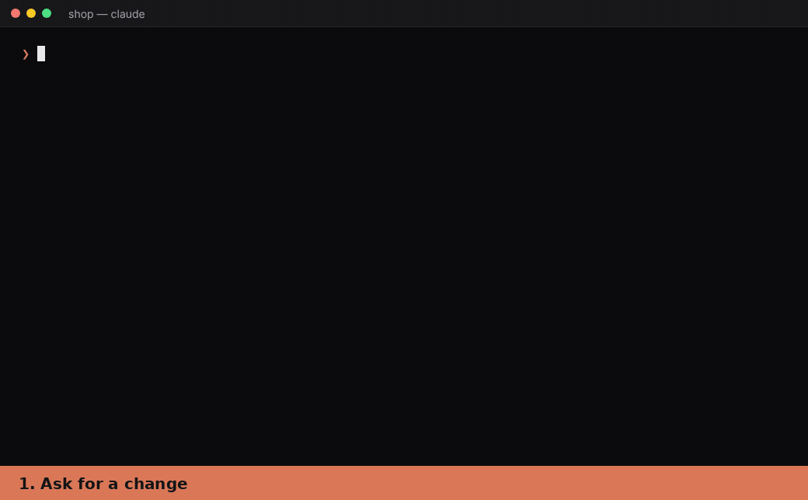

# Mirror

**Your code, mirrored. Intent first, code second.**



A Claude Code plugin. Mirror keeps the intent of each flow and page next to the code, and
shows it in one HTML page.

## Install

```sh
/plugin marketplace add aydinfurkan/mirror
/plugin install mirror@mirror
```

## How it works

Run `mirror:init`. That's all.

From then on, Claude changes the mirror first, you review it, then the code follows.

## What you see

- **The viewer.** One HTML page with every project in a sidebar, its flows and pages by
  group. Click one to read it in the pane: its definition, then its parts, each one foldable.
  Search finds flows, steps and code.
- **A wireframe for each page.** Mirror draws a `design.svg` for each page, in the frame of its
  project: a web page or a phone screen. The page opens as a clickable demo. Click a button to
  follow its action to the next page, or to the backend flow it calls.
- **A review page for each change.** It shows what is added, changed or removed, with the
  changed lines of each action, step and rule. When a page's design changes, switch between
  **After** and **Before** to compare the wireframes. Comment on any line, then paste the
  comments to Claude.
- **Drift check.** `mirror:sync` finds code changes that the mirror does not show yet, and
  flags code that breaks a rule.

## More

- [plugin/README.md](plugin/README.md): what the plugin does, and what it runs, reads and sends.
- [action/](action/): a GitHub Action that links the review page of each pull request in a
  comment, so that reviewers can open it in the browser.
- [examples/shop/](examples/shop/): a demo shop (web, api, worker) described by its mirror. Open
  `examples/shop/.mirror/visualize.html` to see the viewer.
