<!-- Generated by mirror:export from .mirror/xsrc/. Change the mirror, then export again. -->
# shop

## Links

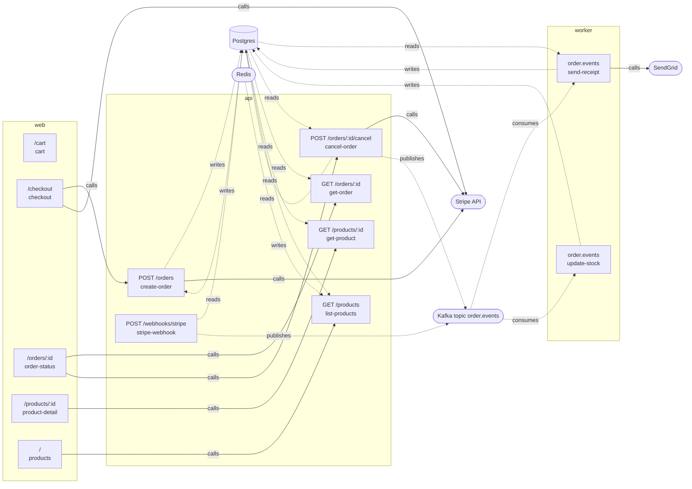

## web/cart

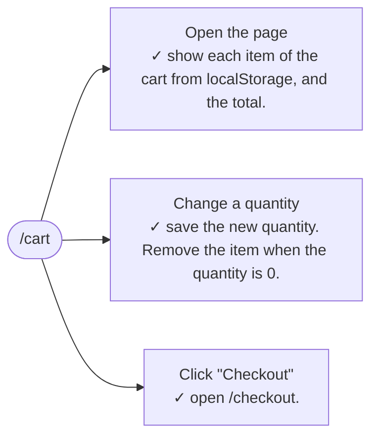

## web/checkout

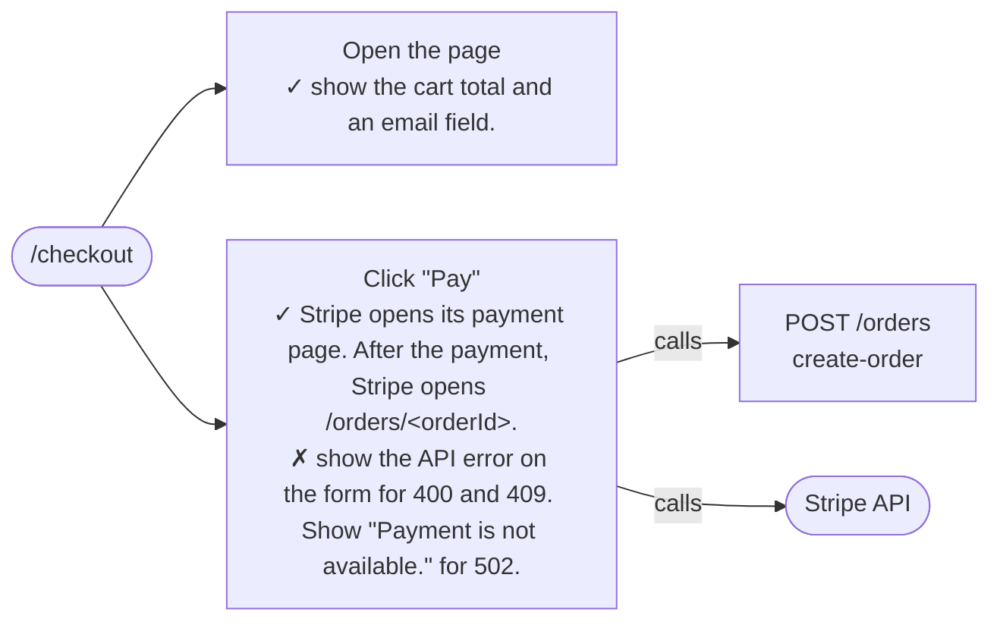

## web/order-status

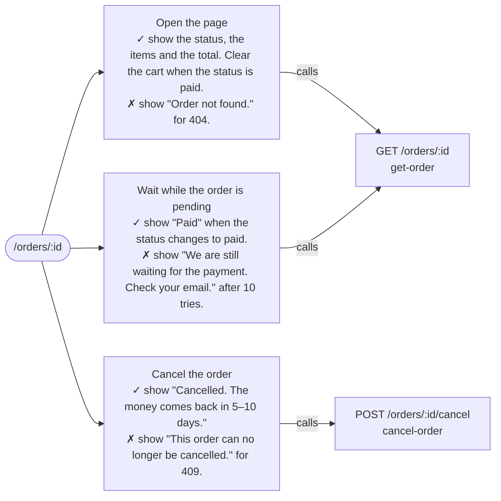

## web/product-detail

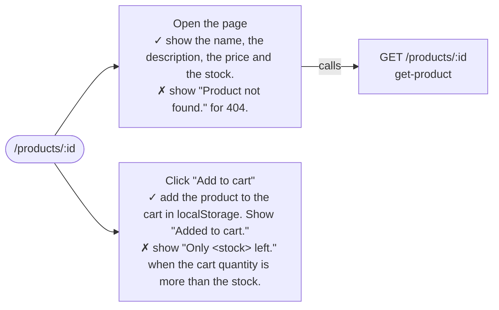

## web/products

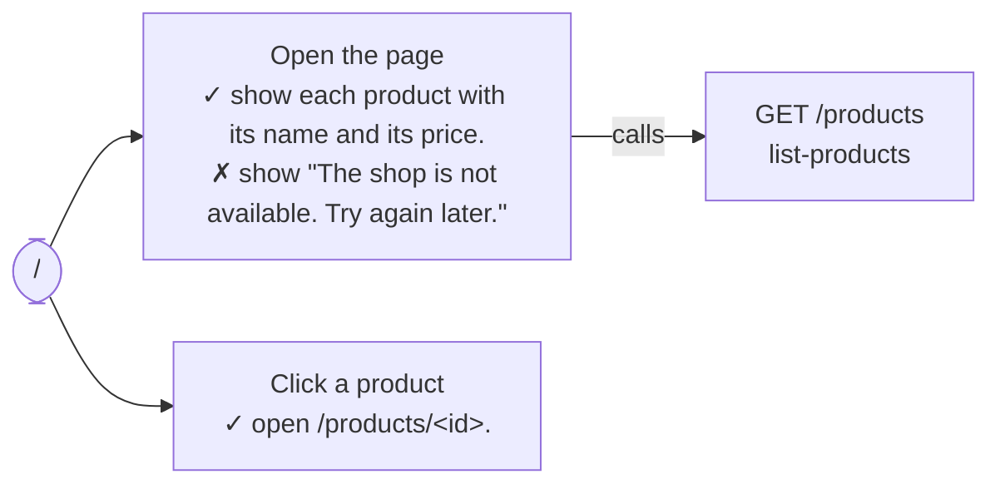

## api/cancel-order

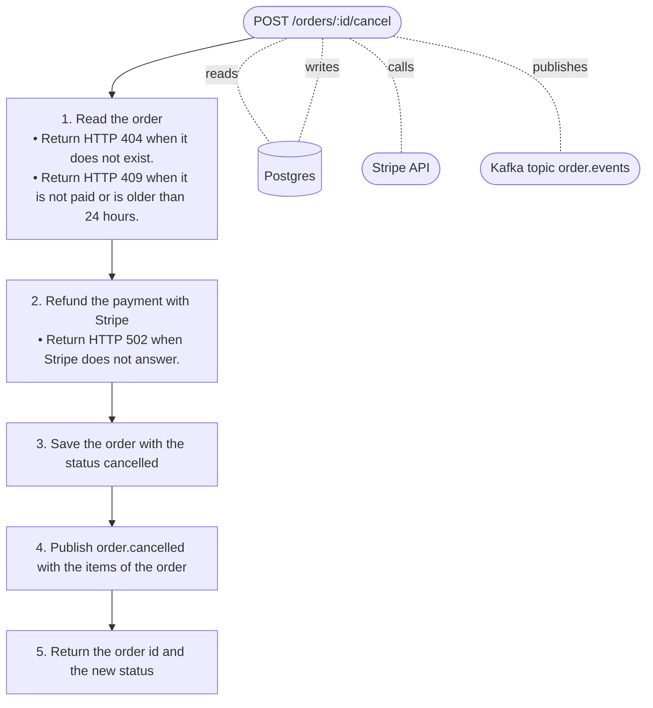

## api/create-order

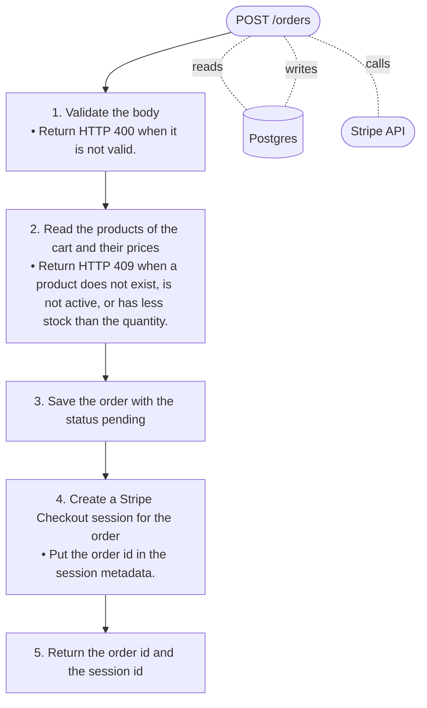

## api/get-order

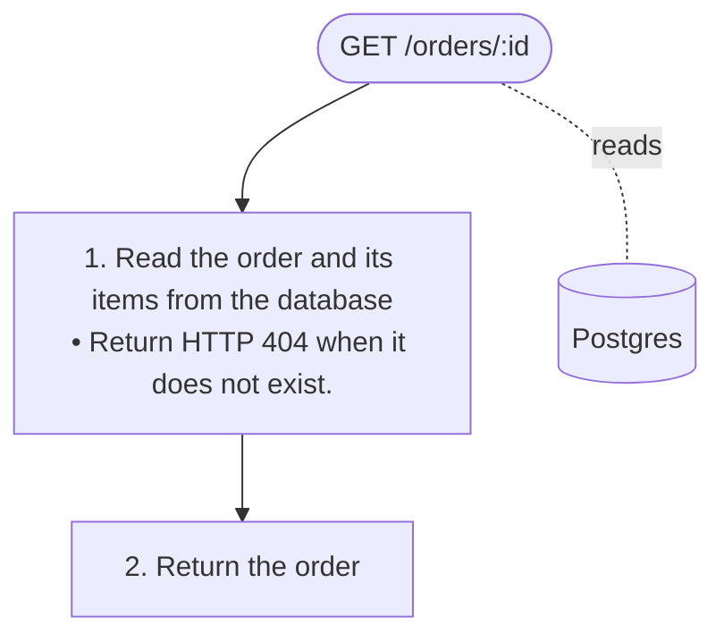

## api/get-product

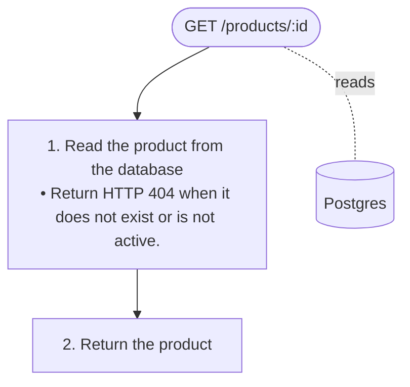

## api/list-products

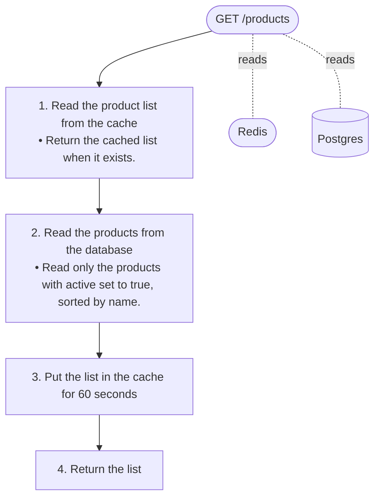

## api/stripe-webhook

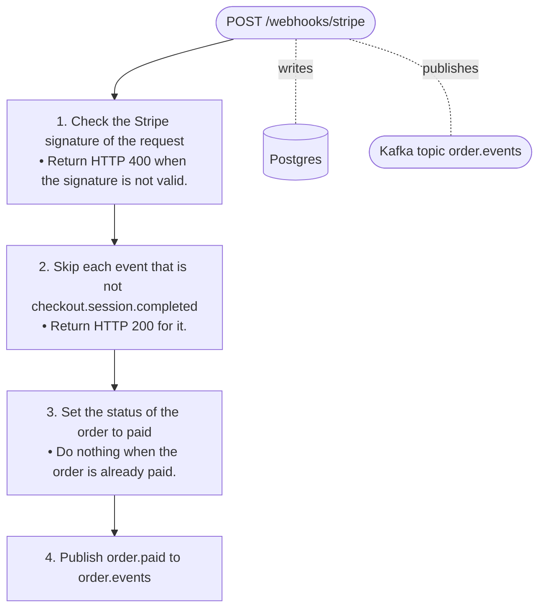

## worker/send-receipt

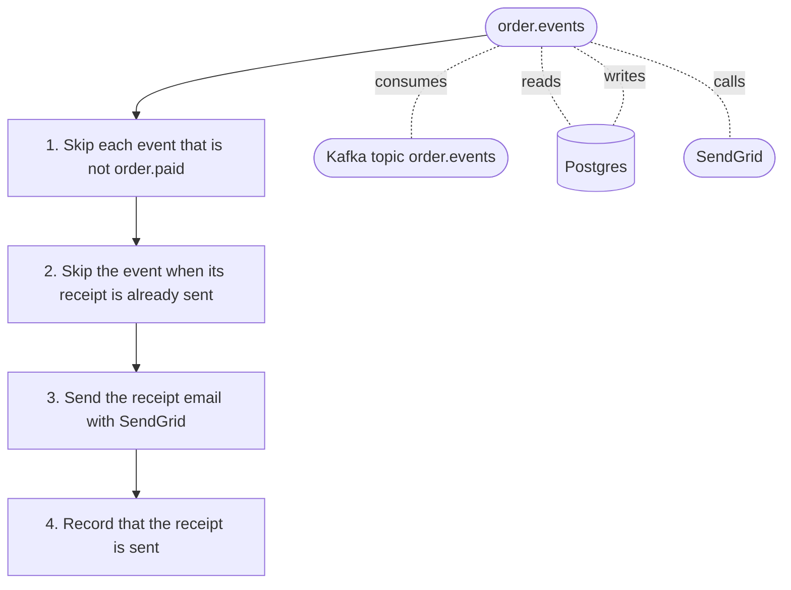

## worker/update-stock

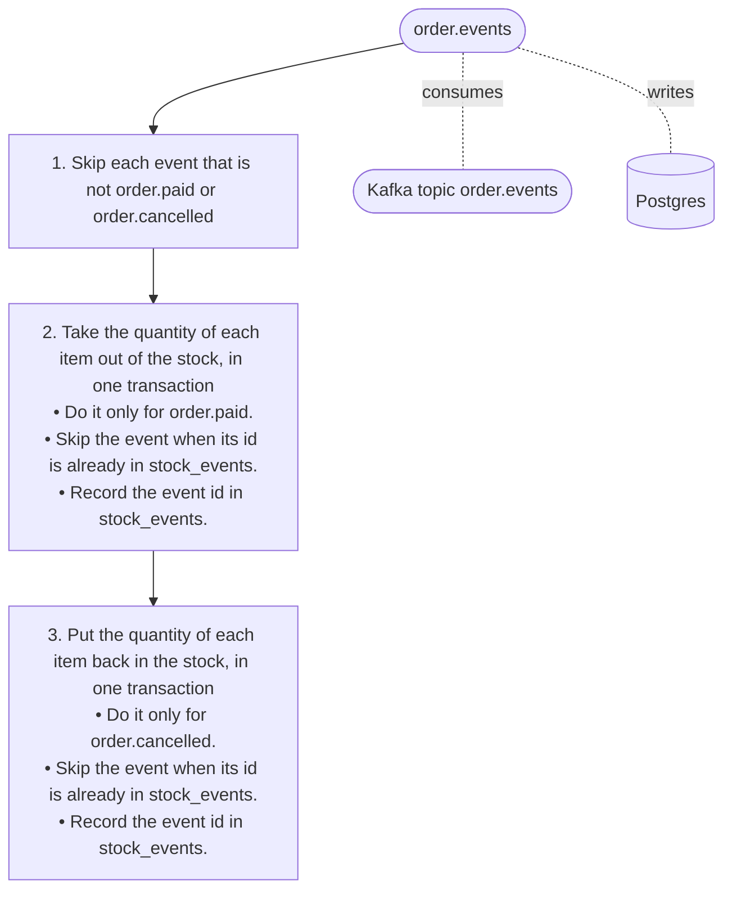
